# DeepONet Surrogate for Airfoil Surface Flow

A DeepONet that predicts the surface pressure and skin-friction distributions on NACA airfoils, trained on the [AirfRANS](https://github.com/Extrality/AirfRANS) RANS dataset. It is then used as a fast approximation for CFD in an inverse-design problem.

**[Try the interactive demo in your browser](https://shankal17.github.io/AirfRANS-DeepONet-Surrogate/)**

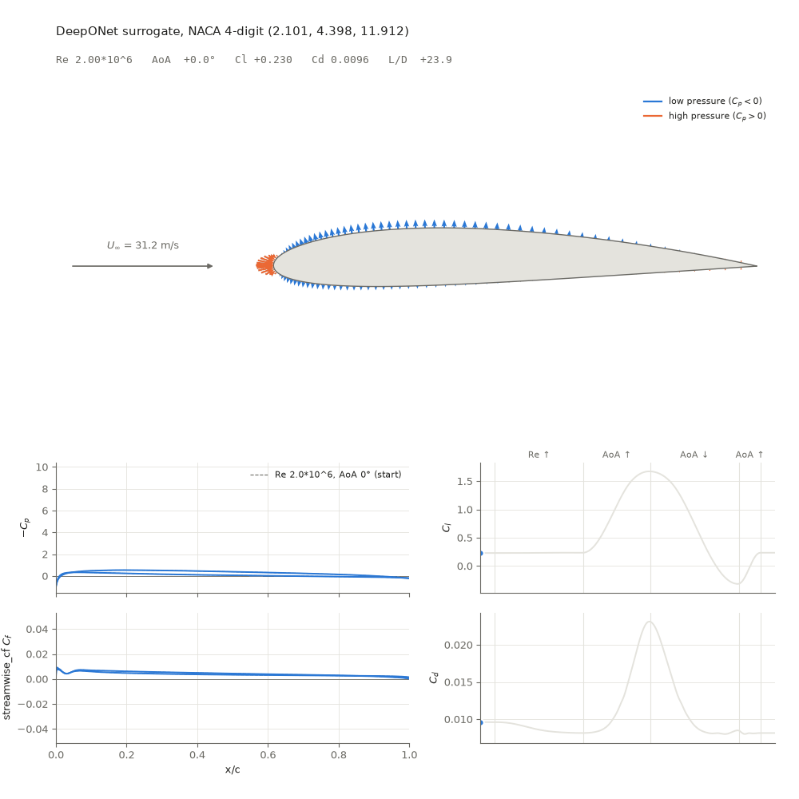

*The surrogate sweeping a NACA 4-digit airfoil through Re $2*10^6$ -> $6*10^6$ at 0° AoA, then AoA 0° -> 15° -> −5° -> 0°. Each frame is a single forward pass. Arrows show the predicted surface pressure coefficient, and the lower panels trace $C_p$, $C_f$, $C_l$ and $C_d$.*

<!-- 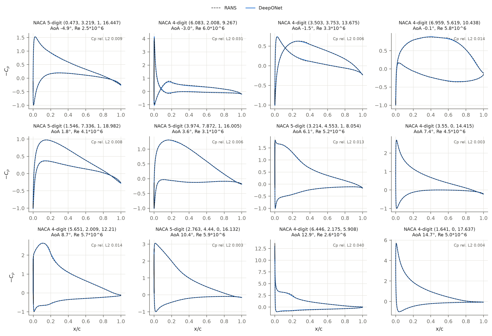 -->

## Table of Contents

- [TL;DR](#tldr)
- [Overview & Purpose](#overview--purpose)
- [Dataset](#dataset)
  - [Surface Extraction](#surface-extraction)
- [Model](#model)
- [Loss Metric](#loss-metric)
- [Training](#training)
- [Evaluation](#evaluation)
  - [Full Run](#full-run)
    - [Loss Curves](#loss-curves)
    - [Accuracy](#accuracy)
  - [Extrapolation](#extrapolation)
    - [AoA Extrapolation Performance](#aoa-extrapolation-performance)
    - [Reynolds Extrapolation Performance](#reynolds-extrapolation-performance)
- [Inverse Problem Example](#inverse-problem-example)
- [Interactive Demo](#interactive-demo)
- [Reproducing the Results](#reproducing-the-results)
- [Repository Layout](#repository-layout)
- [References](#references)

## TL;DR

- **What:** a DeepONet with about 546k parameters. It maps a NACA airfoil's shape, Reynolds number and angle of attack to the pressure coefficient $C_p$ and skin-friction coefficient $C_f$ at every surface mesh point. Lift and drag come from integrating those over the surface.
- **Accuracy:** The model was trained on the 800-case AirfRANS `full` split. On the 200 held-out test cases the errors are:
  - relative L2 error of 0.9% on $C_p$ and 2.3% on $C_f$
  - lift-coefficient mean absolute error of 0.0033
  - mean absolute percentage error (MAPE) of 2.6% on the drag coefficient
- **Cost:** training takes around 3 minutes on one RTX 5070 Ti. Inference takes about 0.13 ms per airfoil in batches on the GPU (≈ 7,700 airfoils/s) and about 1.5 ms on the CPU.
- **Extrapolation:** accuracy degrades steadily but not catastrophically outside the training range. $C_l$ stays within 0.009 MAE and $C_d$ suffers most. MAPE rises to 9.8% for Reynolds-number extrapolation and 18.9% for angle-of-attack extrapolation. I suspect that as the flow seperates, the model would have a tough time, but the AirfRANS dataset doesn't really include many of those. Although with seperated flows in the training data it might be fine, I've seen some crazy demos of DeepONets.
- **Use:** it is fast enough to sit inside a search loop. There is an optimization example included in the repo where we recover an airfoil's NACA parameters from its $C_p$ distribution. Plus it's just a good exploration of DeepONets for more complex applications.

## Overview & Purpose

This project trains a DeepONet [2] to learn the operator

$$\big(\text{airfoil shape},\ Re,\ \alpha\big)\ \longmapsto\ \big(C_p(\mathbf{x}),\ \mathbf{C}_f(\mathbf{x})\big)\quad\text{for } \mathbf{x} \text{ on the airfoil surface},$$

and then integrates those surface fields into lift and drag coefficients.

I wanted to explore DeepONets on a problem more interesting than the textbook examples (integral operators, 1D ODEs, etc) but small enough to train on my home PC. AirfRANS [1] provides 1,000 high-fidelity RANS solutions, so I thought this would be a good place to start.

Also I'd like to note that the same branch/trunk construction applies to higher-dimensional domains and more complex operators, and the literature has DeepONet and related neural operators on 2D and 3D fields with complex geometries [4, 5].

## Dataset

[AirfRANS](https://airfrans.readthedocs.io/en/latest/notes/dataset.html) [1] contains 1,000 steady, incompressible 2D RANS simulations computed with OpenFOAM and the k-ω SST turbulence model [8]. They cover NACA 4-digit (489 cases) and 5-digit (511 cases) airfoils at Reynolds numbers of $2–6*10^6$ and angles of attack from −5° to 15°. If you would like more information on the dataset, take a look at their repo or [paper](https://arxiv.org/abs/2212.07564).


*A sample AirfRANS case*

AirfRANS defines four training splits. I train models on `full`, `reynolds` and `aoa`. For each, 10% of the training split (seed 0) is held out as a validation set for checkpoint selection.

| Task | Train cases | Test cases | What it tests |
|---|---|---|---|
| `full` | 800 (720 train + 80 val) | 200 | interpolation |
| `scarce` | 200 | 200 (the `full` test set) | low-data interpolation |
| `reynolds` | 504 (454 + 50), Re 3–5 M | 496, Re outside 3–5 M | Reynolds-number extrapolation |
| `aoa` | 804 (724 + 80), AoA −2.5° to 12.5° | 196, AoA outside that | angle-of-attack extrapolation |

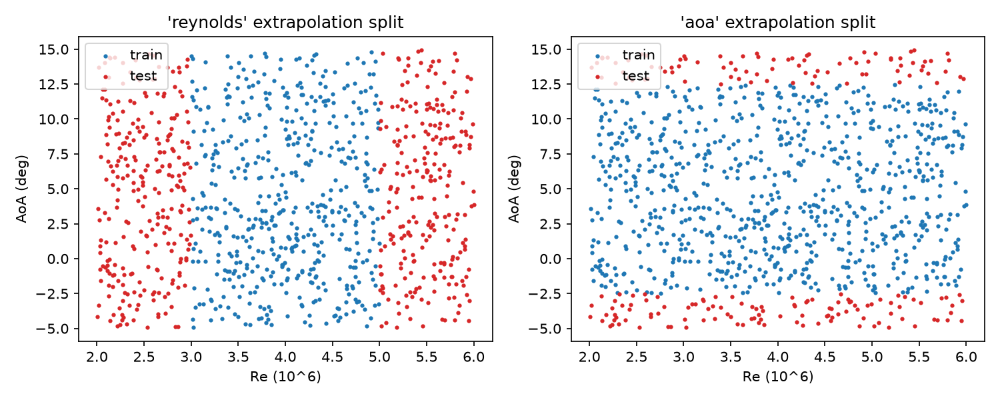
*The `reynolds` and `aoa` training splits plotted as coordinates on an AoA-Reynold's number plane*

### Surface Extraction

AirfRANS stores the full volume solution (velocity, pressure, turbulent viscosity) on the mesh nodes. I keep only the airfoil surface. For each case, [`extract.py`](src/airfrans_surrogate/extract.py) does the following:

1. **Pressure coefficient.** It interpolates the pressure onto the airfoil patch points and sets $C_p = p / (\tfrac12 U_\infty^2)$. AirfRANS pressure is already divided by density.
2. **Skin friction.** It computes the wall-shear-stress vector with `Simulation.wallshearstress` and sets $\mathbf{C}_f = \boldsymbol{\tau}_w / (\tfrac12 U_\infty^2)$.
3. **Surface parameterization.** It walks the surface polyline into an ordered loop and splits it into upper and lower surfaces at the leading edge (min $x$) and trailing edge (max $x$). It also assigns a signed chord coordinate $s$: $+x$ on the upper surface and $-x$ on the lower, so $s$ is continuous through the leading edge.
4. **Shape descriptor.** It interpolates the airfoil's $y$ at 16 cosine-spaced chord stations on each surface, giving 32 numbers (see [`geometry.py`](src/airfrans_surrogate/geometry.py)).
5. **Geometry and reference forces.** It stores the segment connectivity, normals, and lengths that the AirfRANS force integration uses, plus the library's reference $C_l$ and $C_d$.

This shrinks the 15 GB unpacked dataset to 1,000 small `.npz` files (67 MB) plus a `cases.csv` index.

The `validate` stage ([`pipeline/validate.py`](src/airfrans_surrogate/pipeline/validate.py)) checks that integrating the extracted $C_p$ and $C_f$ with my own [`forces.py`](src/airfrans_surrogate/forces.py) reproduces the library's $C_l$ and $C_d$ to within $10^{-6}$ on all 1,000 cases, just as a sanity check.

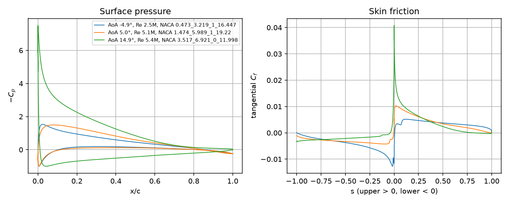
*Some extracted surface pressure and skin friction garphs*
## Model

A vanilla DeepONet [2] approximates an operator $G$ that maps an input function $u$ to an output function evaluated at a query point $y$. A **branch** net encodes $u$ sampled at $m$ fixed "sensor" locations, a **trunk** net encodes $y$, and the output is their inner product:

$$G(u)(y) \approx \sum_{k=1}^{p} b_k\big(u(x_1), \dots, u(x_m)\big)\ t_k(y) + b_0 .$$

The universal approximation theorem for operators [3] guarantees this form can represent any continuous operator. In this problem:

- the input "function" is the airfoil geometry plus the flow conditions
- the query point is a point on the surface
- the output is $[C_p, C_{f,t}]$ at that point

The shape descriptor is just DeepONet sensors applied to the airfoil (see DeepONet paper for mor detail): its $y$ coordinates sampled at 32 fixed chord stations.

[`model.py`](src/airfrans_surrogate/model.py) and [`data.py`](src/airfrans_surrogate/data.py) deviate from the typical DeepOnet in 4 ways:

1. **Stretched chord coordinate with Fourier features.** The first trunk input is $u = \mathrm{sign}(s)\sqrt{|s|}$. This spreads the leading edge, where $C_p$ changes fastest, over a longer interval. The trunk also gets $\sin(k\pi u)$ and $\cos(k\pi u)$ for $k = 1, \dots, 16$. This is similar to Fourier-feature embeddings [6], but with fixed frequencies instead of random ones, so the embedding is deterministic and periodic around the closed surface loop $u \in [-1, 1]$. These features let a small MLP represent the sharp low-pressure peak. The raw $u$, $x$, $y$ and normals still tell the upper and lower trailing edge apart.
2. **Condition-aware trunk.** Besides position and the inward normal $\mathbf{n}$, the trunk sees the surface orientation relative to the freestream: $\mathbf{n}\cdot\mathbf{e}_\infty$ and $\mathbf{n}\times\mathbf{e}_\infty$, with $\mathbf{e}_\infty = (\cos\alpha, \sin\alpha)$. The basis functions can then move with angle of attack (for example, to follow the stagnation point) instead of the branch coefficients doing all the work. To be honest this only led to a small improvement, but I like the idea of spreading the "responsibility" of the network between the trunk and branch. I want to do some more experimentation if this approach could lead to even smaller models though...
3. **Separate basis per output channel.** The branch and trunk each output $2 \times 128$ values. Channel $c$ is $\frac{1}{\sqrt{128}}\sum_k \beta_{ck}\tau_{ck} + b_c$, which matches the "split" multi-output DeepONet discussed in [4]. The $1/\sqrt{p}$ scaling keeps the output's size independent of the number of basis functions at initialization.
4. **Tangential skin friction.** Wall shear stress is tangent to the wall. So the model predicts the scalar $C_{f,t} = \mathbf{C}_f\cdot\hat{\mathbf{t}}$, and $\mathbf{C}_f = C_{f,t}\,\hat{\mathbf{t}}$ is rebuilt from the surface tangent. This removes a redundant output and guarantees the rebuilt vector is tangent. It's always good to introduce inductive biases

Both MLPs have 4 hidden layers of width 256 with GELU activations, for 545,538 trainable parameters in total. All inputs and outputs are standardized with statistics from the training set.

## Loss Metric

The loss ([`trainer.loss_terms`](src/airfrans_surrogate/trainer.py)) has two parts.

**1. Arc-length-weighted field error** on the standardized output channels, pooled over the batch:

$$\mathcal{L}_{\text{field}} = \frac{\sum_{j}\sum_{i} w_{ij}\,\lVert \hat{\mathbf{y}}_{ij} - \mathbf{y}_{ij}\rVert^2}{2\sum_{j}\sum_{i} w_{ij}}, \qquad w_{ij} = (1-\alpha) + \alpha\,\ell_{ij}.$$

Here $j$ runs over cases and $i$ over surface points. $\ell_{ij}$ is the arc length that belongs to point $i$ (half of each adjacent segment), scaled to mean 1 in each case.

The weights are needed because the mesh clusters points at the leading edge. A plain per-point mean would spend about a third of the loss on $x/c < 0.02$. Pure arc-length weighting ($\alpha = 1$) spreads the effort evenly along the chord, and $\alpha = 0.5$ splits the difference between the two. Although I did debate trying without this after I introduced the stretched cord coordinate, but I never did.

**2. Integrated force error.** Predictions are converted back to physical units, $\mathbf{C}_f$ is rebuilt, and the surface is integrated into $C_l$ and $C_d$. The integration is a differentiable, batched PyTorch version of the AirfRANS force integration ([`forces.integrate_coefficients_batch`](src/airfrans_surrogate/forces.py)):

$$\mathcal{L}_{\text{force}} = \frac{1}{2}\left[\left(\frac{\hat C_l - C_l}{\sigma_{C_l}}\right)^2 + \left(\frac{\hat C_d - C_d}{\sigma_{C_d}}\right)^2\right],$$

where $\sigma$ is the training-set standard deviation. Integrated forces are what an engineer actually uses. Small field errors that are spread out can add up in the integral, which matters especially for $C_d \approx 0.01$.

The total loss switches the force term on part-way through training:

$$\mathcal{L} = \mathcal{L}_{\text{field}} + \lambda(e)\,\mathcal{L}_{\text{force}}, \qquad \lambda(e) = \lambda_{\max}\cdot\mathrm{clip}\!\left(\frac{e - 0.3E}{0.2E},\ 0,\ 1\right),$$

where $e$ is the current epoch and $E$ the total number of epochs. The network learns the fields alone for the first 30% of epochs. The force term then ramps in linearly over the next 20%. I found that the model never really learned the field if I included the force term from the beginning which was a real head scratcher for a while.

**Model selection** uses the mean over validation cases of each case's root loss, $\sqrt{\mathcal{L}_{\text{field}} + \lambda_{\max}\mathcal{L}_{\text{force}}}$, always computed with the full force weight. That keeps scores comparable before, during and after the ramp. The best-scoring epoch is kept.

## Training

[`TrainConfig`](src/airfrans_surrogate/config.py) is a dataclass for all of the training parameters, and [`experiments/full_training_and_validation.py`](experiments/full_training_and_validation.py) specifies them for the `full` training run. Here are the parameters for the training run used for the later metrics

| Setting | Value | Notes |
|---|---|---|
| `epochs` | 2000 | None |
| `batch_size` | 32 | None |
| optimizer | AdamW [9] | `learning_rate` 1e-3, `weight_decay` 1e-4 |
| scheduler | OneCycleLR [10] | 5% warm-up to 1e-3, then cosine annealing to 0 |
| gradient clipping | 1.0 | None |
| `force_weight` ($\lambda_{\max}$) | 0.001 | chosen with [`sweep_force_weight.py`](experiments/sweep_force_weight.py) over {0, 1e-4, 1e-3, 3e-3, 1e-2} |
| `force_start` | 0.3 | None |
| `length_weight` ($\alpha$) | 0.5 | per-point vs per-arc-length weights |
| `cf_tangential` | true | predict $[C_p, C_{f}]$ |
| `trunk_aoa` | true | trunk gets AoA as well as the branch |
| `hidden_layer_width` × `num_hidden_layers` | 256 × 4 | for both MLPs |
| `n_basis` | 128 | per output channel |
| `n_fourier` | 16 | frequencies $\pi, 2\pi, \dots, 16\pi$ |
| `model_selection_metric` | `case_rmse` | see [Loss Metric](#loss-metric) |
| `seed` | 0 | initialization, batch order and validation split |

One 2000-epoch training run, including data loading, takes around 3 minutes on an RTX 5070 Ti (16 GB) with an Intel Core Ultra 7 265KF.

## Evaluation

[`pipeline/evaluate.py`](src/airfrans_surrogate/pipeline/evaluate.py) computes these metrics on each split:

- **$C_p$ / $C_f$ relative L2:** $\lVert\hat{\mathbf{y}} - \mathbf{y}\rVert_2 / \lVert\mathbf{y}\rVert_2$ over a case's surface points, averaged over cases.
- **$C_l$ MAE, $C_d$ MAE, $C_d$ MAPE, $L/D$ MAE:** errors on the integrated forces.
- **Spearman ρ:** rank correlation between predicted and true $C_l$ or $C_d$ across the split.
- **$C_p$ RMSE by region:** arc-length weighted, at the leading edge ($x/c < 0.02$), mid-chord, and trailing edge ($x/c \ge 0.95$).

### Full Run

#### Loss Curves

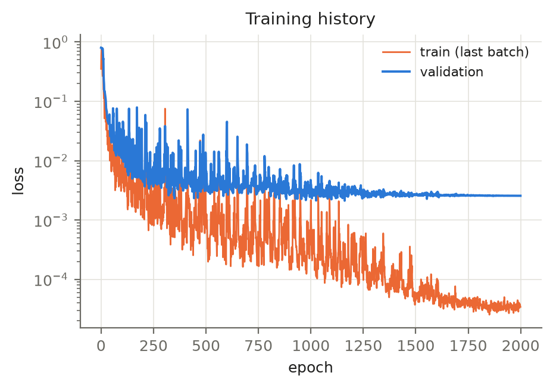

- Both curves drop by two orders of magnitude within about 100 epochs, during the learning-rate warm-up.
- Loss spikes are frequent while the learning rate is high. They die out as OneCycle anneals it, and both curves flatten in the last third of training.
- Validation plateaus near $2.6\times10^{-3}$ by about epoch 1300, while the training loss keeps falling to about $3.5\times10^{-5}$.

After playing around with various hyperparameters, I'm convinced taht the remaining gap is the generalization error at this amount of data. Also, more epochs did not close said gap

#### Accuracy

Metrics on the 200 held-out `full` test cases:

| Metric | Value |
|---|---|
| $C_p$ relative L2 | **0.92%** |
| $C_f$ relative L2 | **2.3%** |
| $C_l$ MAE | **0.0033** |
| $C_d$ MAE | **3.9 counts** (0.00039) |
| $C_d$ MAPE | **2.6%** |
| $L/D$ MAE | 1.5 |
| Spearman ρ ($C_l$ / $C_d$) | 0.9999 / 0.982 |
| $C_p$ RMSE: leading edge / mid-chord / trailing edge | 0.032 / 0.008 / 0.005 |

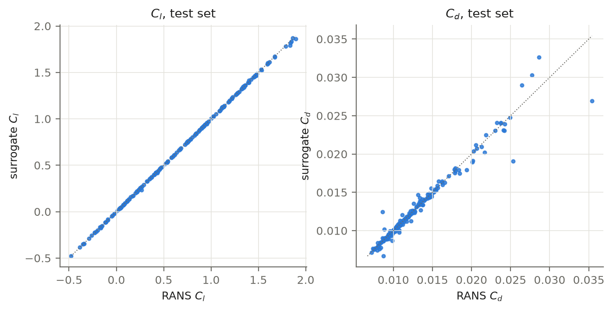

$C_l$ is really good and $C_d$ is a bit worse. It is a small number and mostly viscous, so it depends on $C_f$, which is two orders of magnitude smaller than $C_p$ and has a finer structure. Most of the tuning and modifications to standard DeepONet (see [Model](#model)), was to try and improve $C_d/C_f$, which actually worked pretty well. $C_d$ predictions were terrible before those mods.

The leading edge seems dominates the $C_p$ error. Its RMSE is about 4× the mid-chord error and 6× the trailing-edge error which is aother reason for some of the mods.


*Some example test airfoils. The ground truth RANS derived $C_p$ and the DeepONets predictions are plotted on top of one another*
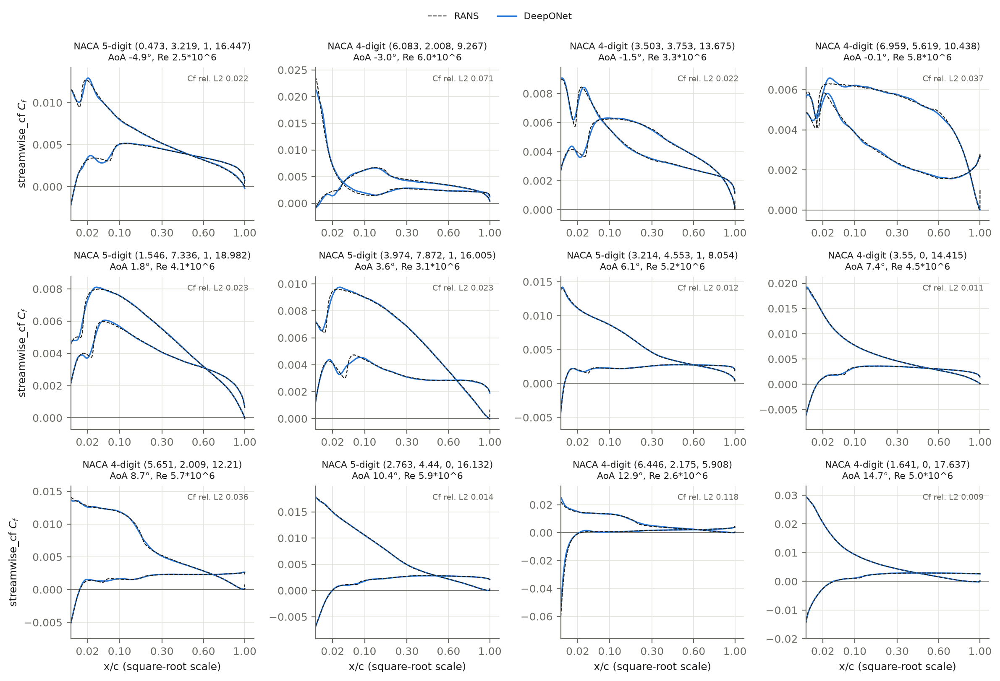
*Some example test airfoils. The ground truth RANS derived $C_f$ and the DeepONets predictions are plotted on top of one another*

### Extrapolation

To test extrapolation, I trained separate models on the AirfRANS `reynolds` and `aoa` splits, with the same settings as the full run. Each model is evaluated two ways:

- **in range:** its own validation cases, which lie inside the training range but were never trained on
- **extrapolation:** the official test set, which lies entirely outside the training range on one axis

The `full` test set is included for reference.

| Model and split | Cases | $C_p$ rel. L2 | $C_f$ rel. L2 | Leading-edge $C_p$ RMSE | $C_l$ MAE | $C_d$ MAPE | $L/D$ MAE | ρ($C_d$) |
|---|---|---|---|---|---|---|---|---|
| `full`, test (reference) | 200 | 0.92% | 2.3% | 0.032 | 0.0033 | 2.6% | 1.5 | 0.982 |
| `reynolds`, in range | 50 | 1.4% | 2.8% | 0.025 | 0.0044 | 3.5% | 2.1 | 0.971 |
| `reynolds`, **extrapolation** | 496 | 4.5% | 5.4% | 0.147 | 0.0088 | 9.8% | 5.9 | 0.871 |
| `aoa`, in range | 80 | 0.83% | 2.1% | 0.015 | 0.0019 | 1.5% | 1.0 | 0.997 |
| `aoa`, **extrapolation** | 196 | 7.9% | 8.7% | 0.230 | 0.0082 | 18.9% | 5.6 | 0.826 |

The figure below plots each case's $|C_l|$ error against the extrapolated variable. The training range is shaded, blue points are in-range validation cases, and orange points are extrapolation test cases.

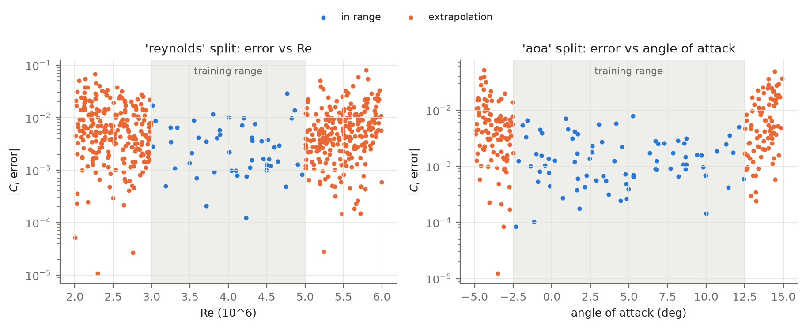

#### AoA Extrapolation Performance

The right panel covers angle of attack.

- **Inside the training range (−2.5° to 12.5°):** $|C_l|$ errors are mostly $10^{-4}$ to $5\times10^{-3}$.
- **Outside it:** errors grow steadily with distance from the boundary, from about $10^{-3}$ at the edge to a few hundredths near −5° and 15°.

Angle of attack mostly controls the leading-edge low-pressure peak, and outside the training range that peak is taller and sharper than anything the model has seen. The leading-edge $C_p$ RMSE grows 15× (0.015 → 0.230), while the mid-chord RMSE grows only from 0.0055 to 0.025.

$C_l$ stays usable (MAE 0.0082) but $C_d$ degrades more. MAPE rises from 1.5% to 18.9%, and the rank correlation falls from 0.997 to 0.826.

The worst predictions are under-predicted low-pressure spikes on thin sections at negative angles of attack while many high-angle cases still track the RANS solution closely.

#### Reynolds Extrapolation Performance

The left panel covers Reynolds number.

- Errors grow on both sides of the 3–5 M training band, roughly symmetrically, with a typical $|C_l|$ error of $10^{-3}$ to $10^{-2}$ and a tail up to about 0.08.
- The overall degradation is milder than for angle of attack: $C_p$ relative L2 goes from 1.4% to 4.5%, $C_l$ MAE doubles, and $C_d$ MAPE goes from 3.5% to 9.8%.

## Inverse Problem Example
A benefit of a fast surrogate model is that they can be run in high volume inside optimization loops (assuming they're accurate enough for whatever task your doing, and smooth enough for whatever optimization approach you're trying). I wanted to demonstrate this so I made a little example. Admittedly it's not very practical, but it does demonstrate the model in an optimization loop. Also, even though it's a little manufactured for demonstration purposes, the objective function can be easily replaced with something of real interest, like choosing an airfoil to minimize drag over a specified range of flight conditions.

**The problem** ([`experiments/inverse_design.py`](experiments/inverse_design.py)): given a target $C_p$ distribution at a known Reynolds number and angle of attack, find the NACA airfoil that produces it.

The targets are real RANS $C_p$ distributions from five held-out `full` test cases, spread across angle of attack. Because the true airfoil is known, we can actually check our answers.

**The search** uses the cross-entropy method (CEM) [7]:

1. Sample 256 candidate parameter vectors.
2. Run every candidate through the surrogate in one batched forward pass
3. Keep the best 10%
4. Fit a diagonal Gaussian to those best candidates and sample the next 256 from it. A small floor on the spread stops it from collapsing too early.
5. Repeat for x number of iterations or until convergence.

The loss is the $C_p$ RMSE at 100 chord stations on each surface. The search runs separately in each of the four AirfRANS NACA families (4-digit, 4-digit with $p = 0$, 5-digit, 5-digit reflex), each bounded to its training-set parameter ranges. The family with the lowest loss wins. That adds up to about 15k surrogate evaluations per case, and all five cases run in about a minute, not counting the animations.

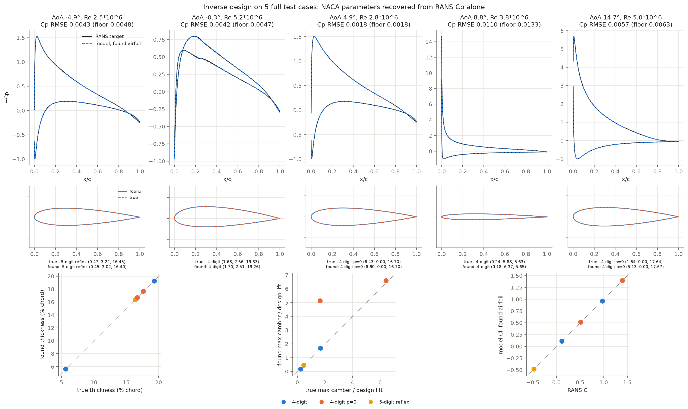
*Inverse design on five test cases*

The parameters are (max camber% or design lift, camber position, thickness%):

| AoA | Re | True airfoil | Found airfoil | $C_p$ RMSE (floor) | $C_l$ found / RANS | $C_d$ found / RANS |
|---|---|---|---|---|---|---|
| −4.9° | 2.53 M | 5-digit reflex (0.47, 3.22, 16.45) | 5-digit reflex (0.45, 3.02, 16.40) | 0.0043 (0.0048) | −0.478 / −0.478 | 0.0112 / 0.0111 |
| −0.3° | 5.23 M | 4-digit (1.68, 2.56, 19.33) | 4-digit (1.70, 2.51, 19.26) | 0.0042 (0.0047) | 0.115 / 0.114 | 0.0101 / 0.0098 |
| 4.9° | 2.79 M | 4-digit p=0 (6.43, 0.00, 16.70) | 4-digit p=0 (6.60, 0.00, 16.70) | 0.0018 (0.0018) | 0.515 / 0.514 | 0.0113 / 0.0111 |
| 8.8° | 3.78 M | 4-digit (0.24, 5.88, 5.63) | 4-digit (0.18, 6.37, 5.65) | 0.0110 (0.0133) | 0.965 / 0.973 | 0.0127 / 0.0135 |
| 14.7° | 5.03 M | 4-digit p=0 (1.64, 0.00, 17.64) | 4-digit p=0 (5.13, 0.00, 17.67) | 0.0057 (0.0063) | 1.397 / 1.394 | 0.0223 / 0.0218 |

**Results:**

- **Every search reaches the floor or beats it**, and the correct family wins in all five cases.
- **Thickness is recovered to within 0.08% of chord** every time. The $C_l$ of the found airfoil matches RANS to within 0.009.
- **Two cases didn't converge to the ground truth.** In both, the parameter that was missed barely changes the airfoil's shape

**Case 1:** 5-digit reflex, AoA −4.9°

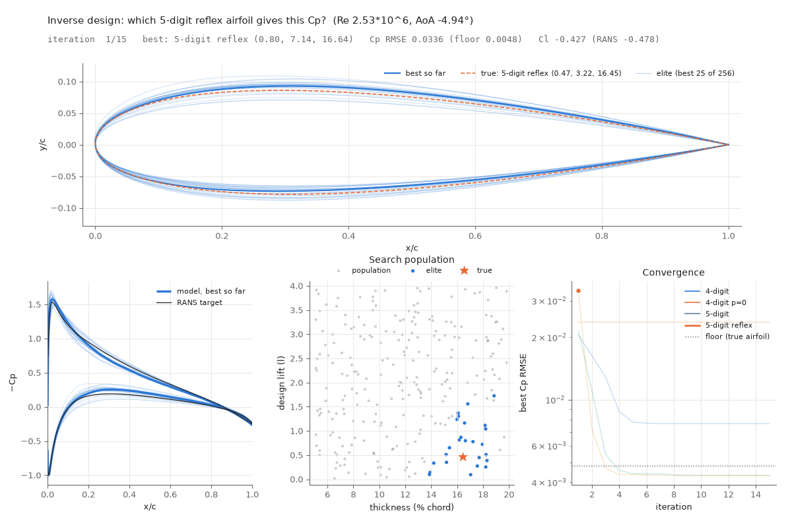

**Case 3:** 4-digit p=0, AoA 4.9°

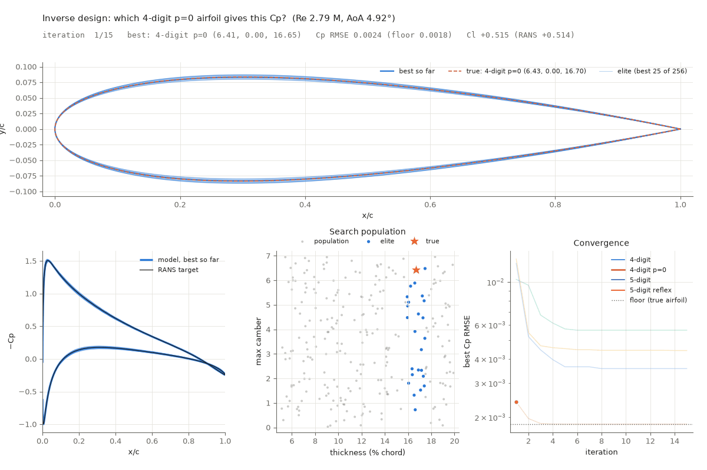

**Case 4:** thin 4-digit, AoA 8.8°

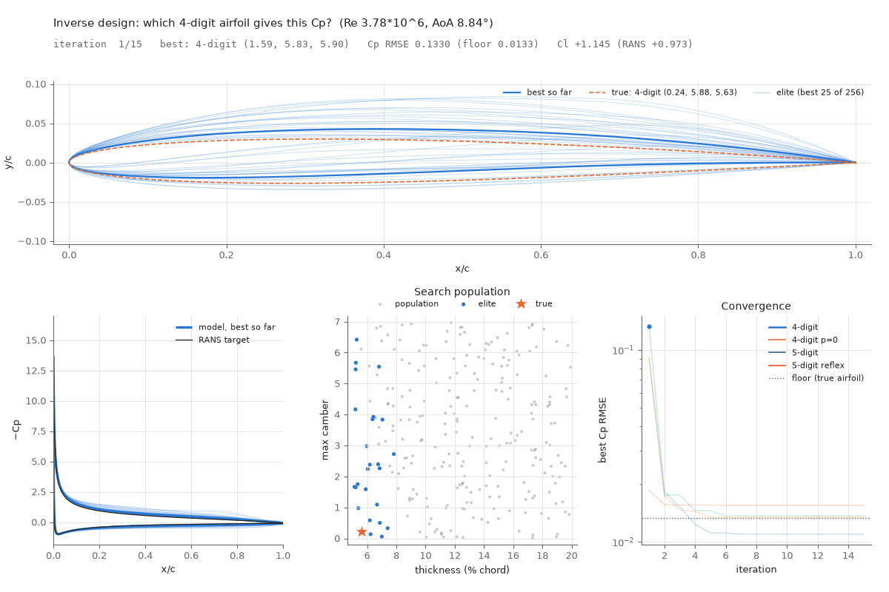

**Case 5:** 4-digit p=0, AoA 14.7° (camber not identifiable)

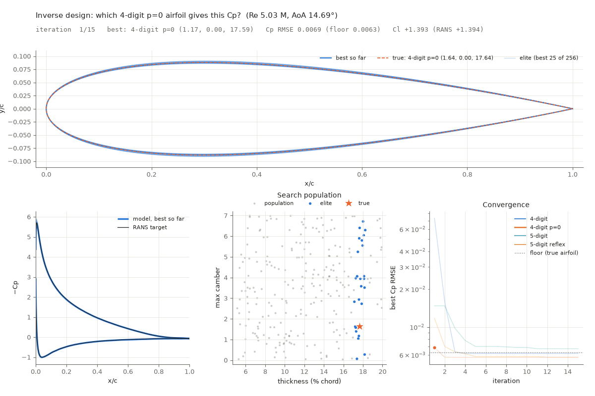


## Interactive Demo
There's a demo of the model that runs right in your browser! Try if it you want

**[shankal17.github.io/AirfRANS-DeepONet-Surrogate](https://shankal17.github.io/AirfRANS-DeepONet-Surrogate/)**

## Reproducing the Results

Requirements: Python ≥ 3.12 and [Poetry](https://python-poetry.org/). A CUDA GPU is strongly recommended for training but not required.

```bash
git clone https://github.com/shankal17/AirfRANS-DeepONet-Surrogate.git
cd AirfRANS-DeepONet-Surrogate
poetry install              # add `--with dev` for the ONNX export (export_web.py)
```

Run every script from the repository root, because the configured paths are relative. Run the following scripts in order to download the AirfRANS dataset, train and evaluate the model, and then optionally performa the inverse design and benchmark the model's inference.

| Step | Command | What it does |
|---|---|---|
| 1 | `poetry run python experiments/prepare_data.py` | Downloads AirfRANS (9.4 GB zip, 15 GB unpacked) into `data/raw/`, extracts surfaces into `data/surface/`, and validates them. |
| 2 | `poetry run python experiments/full_training_and_validation.py` | Trains the `full`, `reynolds` and `aoa` models into `runs/<task>/`, evaluates them (`results/metrics.json`, `figures/eval/`), and plots the galleries. |
| 3 | `poetry run python experiments/inverse_design.py` | Inverse-design example, written to `figures/inverse/`. |
| 4 | `poetry run python experiments/time_inference.py` | Prints GPU/CPU inference timings. |

## References

1. F. Bonnet, J. A. Mazari, P. Cinnella, P. Gallinari. **AirfRANS: High Fidelity Computational Fluid Dynamics Dataset for Approximating Reynolds-Averaged Navier–Stokes Solutions.** *NeurIPS 2022 Datasets and Benchmarks Track.* [arXiv:2212.07564](https://arxiv.org/abs/2212.07564). Library docs: [airfrans.readthedocs.io](https://airfrans.readthedocs.io/).
2. L. Lu, P. Jin, G. Pang, Z. Zhang, G. E. Karniadakis. **Learning nonlinear operators via DeepONet based on the universal approximation theorem of operators.** *Nature Machine Intelligence* 3, 218–229 (2021). [arXiv:1910.03193](https://arxiv.org/abs/1910.03193)
3. T. Chen, H. Chen. **Universal approximation to nonlinear operators by neural networks with arbitrary activation functions and its application to dynamical systems.** *IEEE Transactions on Neural Networks* 6(4), 911–917 (1995). [doi:10.1109/72.392253](https://doi.org/10.1109/72.392253)
4. L. Lu, X. Meng, S. Cai, Z. Mao, S. Goswami, Z. Zhang, G. E. Karniadakis. **A comprehensive and fair comparison of two neural operators (with practical extensions) based on FAIR data.** *Computer Methods in Applied Mechanics and Engineering* 393, 114778 (2022). [arXiv:2111.05512](https://arxiv.org/abs/2111.05512)
5. N. Kovachki, Z. Li, B. Liu, K. Azizzadenesheli, K. Bhattacharya, A. Stuart, A. Anandkumar. **Neural Operator: Learning Maps Between Function Spaces With Applications to PDEs.** *Journal of Machine Learning Research* 24(89), 1–97 (2023). [arXiv:2108.08481](https://arxiv.org/abs/2108.08481)
6. M. Tancik, P. P. Srinivasan, B. Mildenhall, S. Fridovich-Keil, N. Raghavan, U. Singhal, R. Ramamoorthi, J. T. Barron, R. Ng. **Fourier Features Let Networks Learn High Frequency Functions in Low Dimensional Domains.** *NeurIPS* 2020. [arXiv:2006.10739](https://arxiv.org/abs/2006.10739)
7. P.-T. de Boer, D. P. Kroese, S. Mannor, R. Y. Rubinstein. **A Tutorial on the Cross-Entropy Method.** *Annals of Operations Research* 134, 19–67 (2005).
8. F. R. Menter. **Two-equation eddy-viscosity turbulence models for engineering applications.** *AIAA Journal* 32(8), 1598–1605 (1994).
9. I. Loshchilov, F. Hutter. **Decoupled Weight Decay Regularization.** *ICLR* 2019. [arXiv:1711.05101](https://arxiv.org/abs/1711.05101)
10. L. N. Smith, N. Topin. **Super-Convergence: Very Fast Training of Neural Networks Using Large Learning Rates.** *Proc. SPIE* 11006 (2019). [arXiv:1708.07120](https://arxiv.org/abs/1708.07120)
